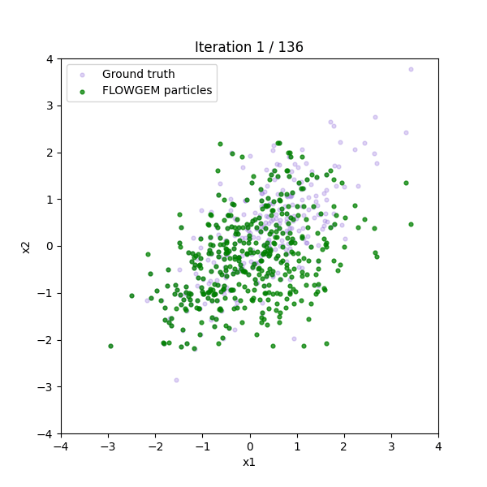

# Usage guide

The aim of this guide is to provide practical information about the practical usage of FLOWGEM. It includes basic use, working with missing data, choosing hyperparameters, initialisation, and inspecting the gradient flow.

## Basic usage

FLOWGEM recieves an array with missing values (indicated as `NaN`) and returns a complete array from the same distribution.

```python
import numpy as np
from flowgem import FlowGEM

# a small correlated dataset
rng = np.random.default_rng(0)
X = rng.multivariate_normal(
    mean=[0, 0, 0],
    cov=[[1.0, 0.7, 0.0],
         [0.7, 1.0, 0.0],
         [0.0, 0.0, 1.0]],
    size=500,
)

# keep a clean copy so we can compare the recovered structure
X_true = X.copy()

# introduce some missing values (NaN)
X[rng.random(500) < 0.2, 1] = np.nan   # ~20% missing in column 1

# generate a complete sample
model = FlowGEM(T=1000, random_state=0)
X_complete = model.fit(X).generate()

print(X_complete.shape)             # (500, 3)
print(np.isnan(X_complete).any())   # False
print(round(np.corrcoef(X_true[:, 0], X_true[:, 1])[0, 1], 2))       # 0.68
print(round(np.corrcoef(X_complete[:, 0], X_complete[:, 1])[0, 1], 2))  # 0.69
```

The returned `X_complete` is a numpy array of the same shape as `X`, a complete dataset (without missing values) drawn from the same distribution as original data. The recovered sample maintains the **correlation structure** of the data, which makes FLOWGEM generative as it produces a full sample from the joint distribution.

## Working with missing data

FLOWGEM assumes `NaN` entries in the input as a missing value. You don't build a mask yourself. The missingness pattern is inferred internally.

```python
import numpy as np
from flowgem import FlowGEM

X = np.array([
    [1.2,    0.8,    3.1],
    [0.5,    np.nan, 2.7],
    [np.nan, 1.4,    2.9],
    [2.1,    0.3,    np.nan],
])

X_complete = FlowGEM(T=1000, random_state=0).fit(X).generate()
```

Each row can have its own missingness pattern. It also includes non-monotone MAR for which FLOWGEM is specifically designed to handle.

**Requirements for the input:**

- Values must be **continuous** (floating point).For now, *FLOWGEM only supports continuous features.* categorical/mixed-type data is future work.
- Every column must have **at least some observed values**. A fully missing coloumn cannot be recovered. Instead, an error is raised.
- Missing entries should be marked as `np.nan`.

## Choosing hyperparameters

There are three main hyperparameters of FLOWGEM. Defaults work across a wide range of datasets, that's why you rarely need to tune them.

### `T` - number of steps (default: 1000)

This is the number of gradient-flow iterations. More steps can lead the particles settle closer to the target distribution.

- **Larger `T`** → better results, but slower.
- There is **no accuracy trade off**: a larger `T` (with a smaller `eta`) only helps. The only cost is computational time.
- Early stopping halts automatically once the particles stop moving, that's why a larger `T` is safer.

### `eta` - step size η (default: 0.01)

How far the particles move at each step.

- **Smaller `eta`** → convergence will be finer and more stable, but it needs more steps.
- If `eta` is too large, the particles will overshoot. FLOWGEM will detect this and halves the `eta` automatically.
- Pair a smaller `eta` with a larger `T`.

### `sigma` - kernel bandwidth (default: `None`)

Determine and control that how "local" the velocity estimate is around each point.

- **`None`** (default) → selected automatically with median heuristic. It is Recommended.
- If data is ** float** → use a fixed bandwidth.
- If data is a ** list** → CV (cross-validate) with candidates and pick the best.
- Unlike `T` and `eta`, `sigma` needs more care. Both too small and too large values degrade results. We recommend to prefer the default heuristic.

Other parameters (`random_state`, `grad_tol`, `min_iter`, `dtype`) are documented in the API reference.

## Initialization

FLOWGEM starts the gradient flow from an initial complete ensemble (`X0`), which is created by filling in the missing values. This is controlled by `init` argument.

### `init="mice"` (default)

Fills the missing values using MICE (via `hyperimpute`), giving a strong, data adaptive starting point. This is most Recommended.

```python
model = FlowGEM(init="mice").fit(X).generate()
```

### `init="sample"`

Fills each missing value by resampling the observed values in the same column. It isighter and faster than MICE, with no extra dependencies, but it needs way larger T than *mice* to reach the similar result.

```python
model = FlowGEM(init="sample").fit(X).generate()
```

### Supplying your own array

You can also pass a complete array (the same shape as `X`) to start. It is useful if you already have an imputation which you trust.

```python
model = FlowGEM(init=my_X0).fit(X).generate()
```

The gradient flow refines any starting point you give it. In this sense, the final result is not too sensitive to the initialisation, but a better `X0` can make the convergence much faster.

## Inspecting the flow (advanced)

By default, `generate()` returns only the final sample. To get the full sequence of snapshots, pass
`return_trajectory=True`. It gives one NumPy
array per gradient-flow step.

```python
model = FlowGEM(T=1000, random_state=0).fit(X)

trajectory = model.generate(return_trajectory=True)
# trajectory is a list of arrays, one per step
# trajectory[-1] is the final sample (same as generate())

print(len(trajectory))        # number of steps taken (may be < T if early-stopped)
print(trajectory[0].shape)    # (n, d)
```

This is useful for:

- **Visualising convergence**:- watching the particles cloud moving toward target distribution over the T.
- **Diagnostics**:- checking how quickly the flow settles. OR why early stopping kicked in before `T` steps.

## The flow in action

The animation below shows the particle cloud flowing toward the target distribution over the gradient-flow iterations. The green particles are gradually approching the ground-truth distribution.

